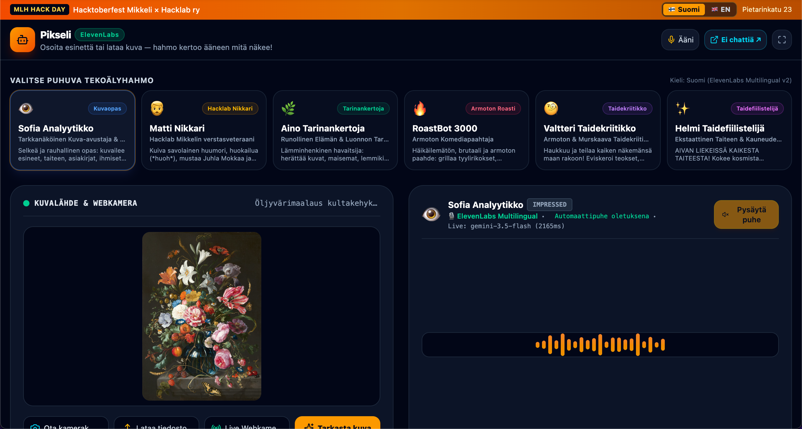
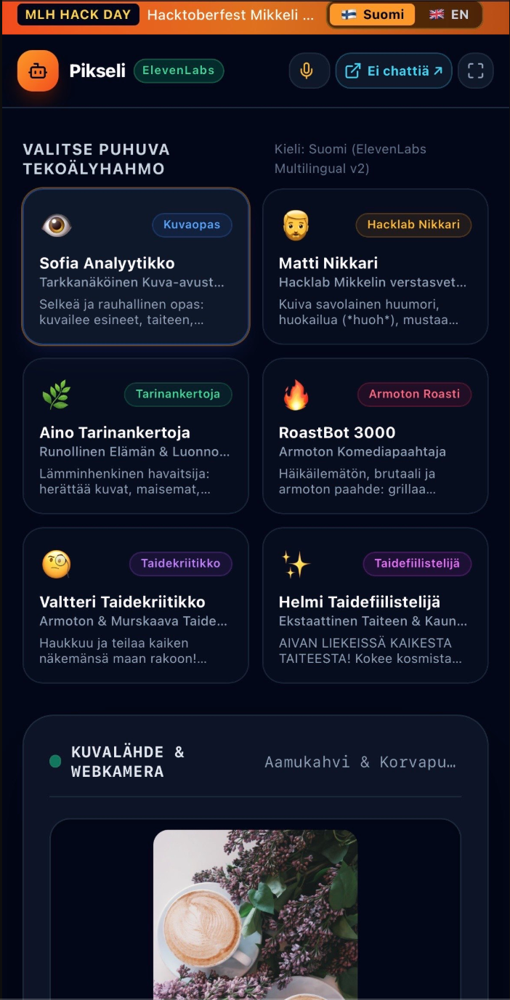

# Pikseli Vision × ElevenLabs

> **Multimodal AI Companion for Makers, Hacklabs & Art Lovers**  
> *Real-time Visual Intelligence meets Expressive Conversational Voices*

---

## 📸 Application Screenshots

### Desktop Viewport


### Mobile Viewport


---

## 🎃 Hackathon Context & Story

Built for **Hacktoberfest Hack Day Mikkeli x Hacklab Mikkeli ry** (31 October 2026, Hacklab Mikkeli, Pietarinkatu 23, Finland), a day of building with open-source AI tools and open-weight models, sponsored by ElevenLabs.

In a real-world workshop or maker lab, your hands are frequently occupied: holding a soldering iron, adjusting a 3D printer bed, running a laser cutter, or inspecting circuit board traces. Constantly switching between tools and a computer screen breaks flow. Furthermore, for visually impaired users or art gallery visitors, static visual captions fail to capture emotional nuance, artistic theory, or pragmatic craftsman advice.

**Pikseli Vision** combines the open-weight **Gemma 4** multimodal model with **ElevenLabs Voice AI** to create a hands-free, multilingual spoken companion that doesn't just describe an image. It interprets it with rich character personality, emotional depth, and targeted interactive Q&A.

---

## 🎯 Hackathon Tracks & Alignment

## 🎯 Hackathon Categories & Alignment

We are entering three prize categories.

### 1. Best Use of Gemma 4
Gemma 4 packs multimodal intelligence into an open-weights model, accessed here through the Gemini API. It is the vision brain of the whole app.

* **Multimodal experience**: Gemma 4 processes camera frames, mobile photo uploads, and workshop macro captures together with text (persona, language, focus tags, and the user's question) to build an assistant that understands more of what users share.
* **Focused AI tool**: A focused companion for makers, hacklab visitors, and art lovers, with six distinct personas, each steering the model through its own prompt constraints.
* **Structured visual extraction**: Isolates 3–4 visual elements (e.g. solder joints, layer heights, optical glare, brushwork techniques) and returns a strictly typed JSON schema (`speechText`, `emotion`, `tags`, `verdict`) that drives interactive tag chips.
* **"Kysy kuvalta" (Visual Q&A)**: Users ask specific questions about what the camera sees ("Why is this corner warping?", "Is this circuit safe?", "Analyze the chiaroscuro") and the model answers in character.
* **Bounding HUD overlays**: Canvas targeting brackets and crosshairs pinpoint focal points on screen.
* **Rapid prototyping**: The Gemini API let us go from idea to a working, deployed prototype within a single hack day.

### 2. Best Project Built with ElevenLabs
ElevenLabs is a core part of how the app works: every analysis is spoken aloud, and voice is the primary output.

* **`eleven_multilingual_v2` engine**: Native, accent-accurate speech synthesis in Finnish (Suomi) and English.
* **Persona voice mapping**: Each of the 6 AI characters is paired with an ElevenLabs voice tailored to their personality (e.g. Arnold for the rugged Finnish baritone craftsman, Rachel for the crisp technical guide, Adam for the sarcastic comedian, Freya for the breathless fine-art fanatic).
* **Backend TTS proxy** (`/api/elevenlabs/tts`): Keeps credentials server-side, converts the streamed audio buffer, and tunes stability/clarity dynamically.
* **Resilient audio pipeline**: If no ElevenLabs key is available or the network drops, the app cascades to native browser `SpeechSynthesis` so the user is never left in silence.
* **Hands-free by design**: Automatic speech on inspection lets makers examine physical prototypes without touching the device.
* **Open source**: All of our own code is published in this public GitHub repository under the **Apache-2.0** license, as the category requires.

---

## 🎭 The 6 AI Personas

| Character | Persona | Personality & Tone | ElevenLabs Voice |
| :--- | :--- | :--- | :--- |
| **Matti the Maker**<br>*(Matti Nikkari)* | 🧔‍♂️ Hacklab Mikkeli Veteran | Dry Finnish maker humor, sighs (*huoh*), sips black Juhla Mokka, inspects solder joints and 3D print layer alignment with decades of workshop wisdom. | **Arnold** *(Deep Finnish Baritone)* / George |
| **Sofia the Vision Guide**<br>*(Sofia Analyytikko)* | 👁️ Articulate Visual Explainer | Calm, analytical, and structured visual observer. Breaks down objects, spatial depth, composition, and physical materials with clarity. | **Rachel** *(Clear Tech & Analytical)* |
| **Aino the Storyteller**<br>*(Aino Tarinankertoja)* | 🌿 Poetic Nordic Observer | Warm Scandinavian storyteller. Captures lighting, mood, lake sceneries, food, and daily life with sensory poetry. | **Charlotte** *(Nordic Expressive Warmth)* |
| **RoastBot 3000**<br>*(Armoton Paahtaja)* | 🔥 Savage Comedy Roaster | Aggressive, ruthless stand-up comedy roaster. Zero filter, zero mercy. Devastates terrible wiring, messy desks, and chaotic life choices with razor-sharp burns. | **Adam** *(Punchy Sarcastic Delivery)* |
| **Julian the Art Critic**<br>*(Valtteri Taidekriitikko)* | 🧐 Merciless High-Art Connoisseur | Scathing, elitist art theorist. Eviscerates bourgeois kitsch, amateurish chiaroscuro, and existential creative bankruptcy with haughty contempt. | **Daniel** *(Authoritative Haughty Resonance)* |
| **Helmi the Art Lover**<br>*(Helmi Taidefiilistelijä)* | ✨ Ecstatic Fine-Art Fanatic | Hyper-enthusiastic, breathless art lover. Experiences transcendent cosmic epiphanies and happy tears over every painting, laser cut, and coffee crema. | **Freya** *(Expressive, Energetic & Breathless)* |

---

## 🛠️ Detailed Technical Architecture

```
┌──────────────────────────────────────────────────────────┐
│                   Client Browser (React 19)               │
│  - Live Webcam Stream / Photo Upload / Preset Gallery    │
│  - 6 Persona Selectors (Custom Prompt Engineering)       │
│  - "Kysy kuvalta" Visual Q&A with Quick-Chips            │
│  - Persistent Audio Element & Web Speech Keep-Alive Loop │
└────────────┬─────────────────────────────▲───────────────┘
             │ HTTP POST (Base64 JPEG)      │ JSON & Audio Stream
┌────────────▼─────────────────────────────┴───────────────┐
│               Express Full-Stack Server (Node.js/tsx)    │
│                                                          │
│  ┌────────────────────────┐    ┌──────────────────────┐  │
│  │   /api/vision/analyze  │    │  /api/elevenlabs/tts │  │
│  │  - Primary: Gemini 3.5 │    │  - ElevenLabs proxy  │  │
│  │  - Fallback: Flash Lite│    │  - Multilingual v2   │  │
│  │  - Contextual DSP logic│    │  - Auto buffer cache │  │
│  └───────────┬────────────┘    └──────────┬───────────┘  │
└──────────────┼────────────────────────────┼──────────────┘
               ▼                            ▼
      Google Gemini API            ElevenLabs Voice API
     (gemini-3.5-flash)           (eleven_multilingual_v2)
```

### 1. Multimodal Vision Pipeline
1. Captures live video frame via `HTMLVideoElement` or high-res image upload.
2. Converts and compresses frame client-side to clean `image/jpeg` base64 with guarded offscreen canvas scaling.
3. Sends image payload alongside active persona ID, target language (`fi` | `en`), focus tags, and user question.
4. Gemini 3.5 Flash evaluates the visual scene against role-specific prompt constraints and returns a strictly typed JSON schema containing `speechText`, `emotion`, `tags`, and `verdict`.

### 2. Audio Subsystem & Mobile Browser Hardening
Mobile Safari (iOS) and Chrome (Android) impose strict security policies that frequently break web audio. Pikseli Vision implements comprehensive workarounds:
* **Pre-warmed HTMLAudioElement**: A single persistent `Audio` object is created and primed during the user's initial touch gesture. When async ElevenLabs audio arrives, `audio.src = url` plays smoothly without triggering `NotAllowedError`.
* **Garbage Collection (GC) Protection**: In native `SpeechSynthesis`, local `SpeechSynthesisUtterance` variables are garbage-collected by V8/WebKit after ~1 second, causing speech to suddenly cut off. We anchor utterances to `window.__pikseliActiveUtterance` and `currentUtteranceRef`.
* **Android Chrome Heartbeat Loop**: An 800ms keep-alive timer periodically invokes `speechSynthesis.pause()` and `speechSynthesis.resume()`, preventing the mobile OS from sleeping mid-sentence.
* **Instant Fallback Cascade**: If ElevenLabs network latency spikes or quota is reached, audio automatically reroutes to native Web Speech without user intervention.

---

## 🖼️ Included Realistic Preset Scenarios

12 photorealistic test images covering diverse inspection challenges:

1. **Taidegalleria (Art & Gallery)**
   * Classical Gilded Oil Painting (*Öljyvärimaalaus kultakehyksissä*)
   * Modern Geometric Abstract Canvas (*Moderni abstrakti akryylimaalaus*)
   * Classical Museum Marble Sculpture (*Antiikin marmoriveistos*)
2. **Hacklab Verstas (Makerspace & Engineering)**
   * 3D Printer Prototype Inspection (*Ender-3 3D-tulostin & kerrosjälki*)
   * FabLab CO2 Laser Cutter Engraving (*Laserleikkuri työn touhussa*)
   * SMD Soldering Bench & Stereo Microscope (*Pintaliitostyöpiste & mikroskooppi*)
   * Arduino Circuit & Jumper Wire Breadboard (*Elektroniikkakytkentä & koekytkentälevy*)
3. **Arki & Luonto (Daily Life & Nature)**
   * Morning Coffee & Warm Cinnamon Bun (*Aamukahvi & Korvapuusti*)
   * Golden Retriever in Garden (*Kultainennoutaja puutarhassa*)
   * Nordic Lake Sunset & Wooden Pier (*Laituri & Syysjärvi*)
   * Creative Studio Desk & Clutter (*Luova työpöytä & verstassotku*)
   * Modern Fashion & Outfit (*Muotiasu & katutyyli*)

---

## 🚀 Getting Started

### Prerequisites
* **Node.js**: v20 or higher
* **npm**: v9 or higher

### Installation & Run

1. Clone or download the repository:
   ```bash
   git clone <repo-url>
   cd pikseli-vision
   ```

2. Install dependencies:
   ```bash
   npm install
   ```

3. Configure Environment Variables in `.env` (optional for local API keys):
   ```env
   # Gemini API Key (Injected automatically in AI Studio)
   GEMINI_API_KEY="your-gemini-api-key"

   # ElevenLabs API Key (Optional: can also be entered in app UI Settings)
   ELEVENLABS_API_KEY="your-elevenlabs-api-key"
   ```

4. Launch the fullstack development server:
   ```bash
   npm run dev
   ```
   Open `http://localhost:3000` in your browser.

5. Build for production:
   ```bash
   npm run build
   npm start
   ```

---

## 📜 License
Apache-2.0 License. Built with ❤️ for Hacklab Mikkeli & Multimodal AI Hackathons.
